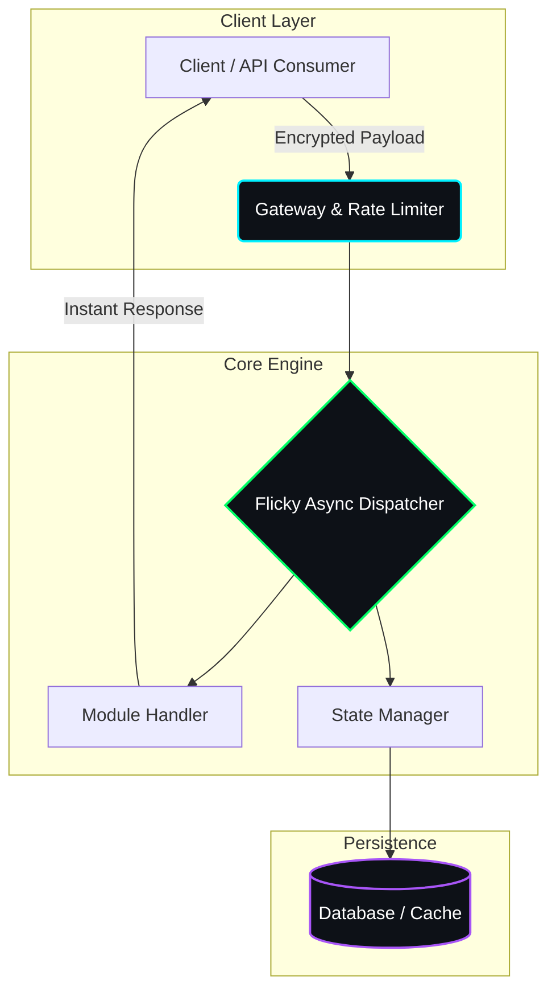

<div align="center">

<!-- Animated Header SVG -->
<a href="https://github.com/aaryush-exe/Flicky">
  
</a>

<p align="center">
  <b>The ultimate high-performance powerhouse engineered for absolute speed, precision, and zero-latency execution.</b>
</p>

<!-- Neon Pill Badges -->
<p align="center">
  <a href="https://github.com/aaryush-exe/Flicky/stargazers">
    
  </a>
  <a href="https://github.com/aaryush-exe/Flicky/network/members">
    
  </a>
  <a href="https://github.com/aaryush-exe/Flicky/issues">
    
  </a>
  <a href="https://github.com/aaryush-exe/Flicky/blob/main/LICENSE">
    
  </a>
</p>

<!-- Quick Nav Links -->
<p align="center">
  <a href="#-core-highlights"><b>Highlights</b></a> •
  <a href="#-system-architecture"><b>Architecture</b></a> •
  <a href="#-quick-start"><b>Quick Start</b></a> •
  <a href="#-configuration"><b>Config</b></a> •
  <a href="#-directory-structure"><b>Structure</b></a> •
  <a href="#-roadmap"><b>Roadmap</b></a>
</p>

<br/>

<!-- Glowing Wave Banner -->


</div>

---

## 🌟 Core Highlights

Most modern tools come packed with heavy overhead, bloated node modules, and sluggish response times. **Flicky** breaks the mold with a custom-built, lightweight execution pipeline.

<table>
  <tr>
    <td width="50%" align="center">
      <h3>⚡ Sub-Millisecond Core</h3>
      <p>Optimized asynchronous event loops ensuring instant throughput even under intense concurrent load.</p>
    </td>
    <td width="50%" align="center">
      <h3>🧩 Plug & Play Modules</h3>
      <p>Decoupled component architecture lets you drop in new features or routes without breaking the core state.</p>
    </td>
  </tr>
  <tr>
    <td width="50%" align="center">
      <h3>🛡️ Built-In Fortification</h3>
      <p>Native rate-limiting, strict payload sanitization, and secure environment isolation out of the box.</p>
    </td>
    <td width="50%" align="center">
      <h3>🐳 Multi-Env Ready</h3>
      <p>Deploy seamlessly on local hardware, scale via Docker containers, or ship straight to cloud runners.</p>
    </td>
  </tr>
</table>

---

## 🏗️ System Architecture



---

## 🛠️ Technology Stack

---

## 🚀 Quick Start

Get **Flicky** up and running on your local machine in under 60 seconds.

### 1️⃣ Clone & Navigate

```bash
git clone [https://github.com/aaryush-exe/Flicky.git](https://github.com/aaryush-exe/Flicky.git)
cd Flicky

```

### 2️⃣ Install Dependencies

Choose your preferred runtime stack:

```bash
# Node.js / Bun
npm install        # or: bun install

# Python
pip install -r requirements.txt

```

### 3️⃣ Configure Environment

Duplicate the template configuration and supply your keys:

```bash
cp .env.example .env

```

### 4️⃣ Launch the Engine 🚀

```bash
# Development Mode (Hot Reload)
npm run dev

# Production Mode
npm start

```

If you prefer running Flicky inside an isolated container:

```bash
# Build the container image
docker build -t flicky:latest .

# Run container with environment mapping
docker run -d --name flicky-engine --env-file .env -p 3000:3000 flicky:latest

```

---

## ⚙️ Configuration Matrix

Fine-tune **Flicky**'s behavior using your `.env` file parameters:

| Variable Name | Type | Default | Description |
| --- | --- | --- | --- |
| `PORT` | `Number` | `3000` | Port assigned to the internal server listener |
| `ENV_MODE` | `String` | `production` | Execution state (`development` vs `production`) |
| `API_SECRET` | `String` | *Required* | Master cryptographic signature token |
| `MAX_WORKERS` | `Number` | `4` | Maximum parallel concurrency worker threads |
| `DEBUG_MODE` | `Boolean` | `false` | Enable verbose terminal debugging outputs |

---

## 📂 Directory Structure

```text
Flicky/
├── 📂 src/
│   ├── 📂 core/          # ⚡ Main execution engine & event loop
│   ├── 📂 modules/       # 🧩 Modular feature controllers
│   ├── 📂 middleware/    # 🛡️ Security, auth & rate limiting
│   └── 📂 utils/         # 🛠️ Helpers, formatters & loggers
├── 📂 config/            # ⚙️ Runtime configuration schemas
├── 📂 tests/             # 🧪 Automated unit & integration tests
├── 🐳 Dockerfile         # Container packaging manifest
├── 📄 .env.example       # Template environment variables
└── 📖 README.md          # Project documentation

```

---

## 🗺️ Development Roadmap

* [x] **v1.0** — Core engine framework & high-speed dispatch pipeline
* [x] **v1.2** — Modular plugin loader & telemetry loggers
* [ ] **v1.5** — Real-time WebSockets & metrics visualization dashboard
* [ ] **v2.0** — Distributed node cluster scaling support

---

## 🤝 Contributing

Got an optimization or feature idea to make **Flicky** even faster? Contributions are welcome!

1. **Fork** the repository (`https://github.com/aaryush-exe/Flicky/fork`)
2. **Create** your feature branch (`git checkout -b feature/lightning-boost`)
3. **Commit** your changes (`git commit -m 'feat: optimized dispatcher latency by 35%'`)
4. **Push** to the branch (`git push origin feature/lightning-boost`)
5. **Open** a Pull Request

---

## 📜 License

Distributed under the **MIT License**. See [`LICENSE`](https://www.google.com/search?q=LICENSE) for complete details.

---

### ⭐ Leave a star if Flicky accelerated your workflow!

Crafted with 💻 & ⚡ by **[aaryush-exe](https://github.com/aaryush-exe)**
